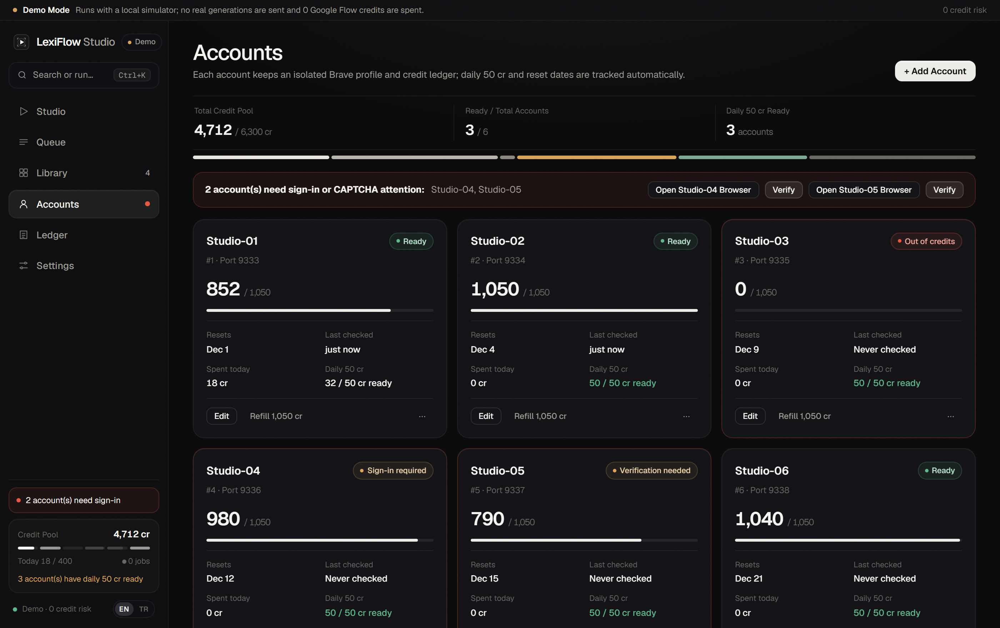
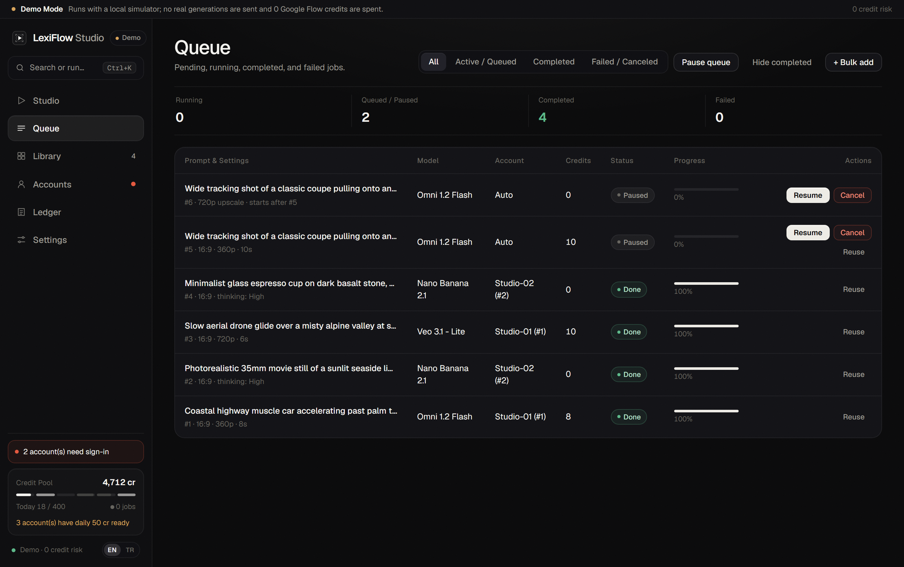
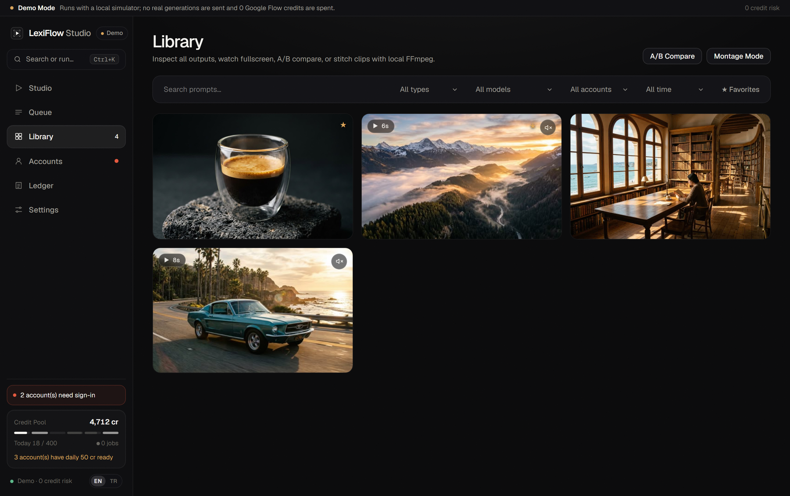
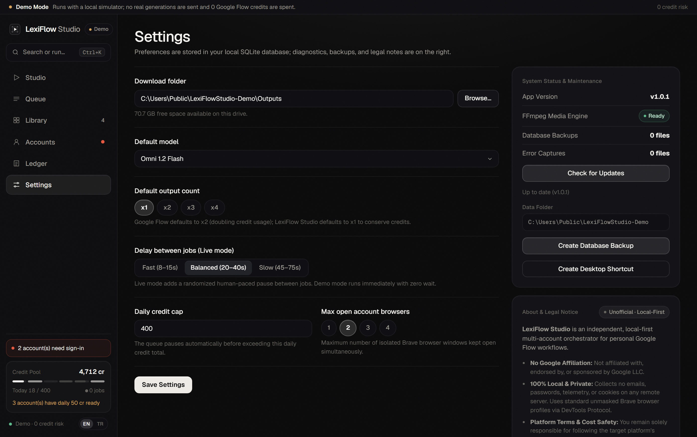

<div align="center">

# LexiFlow Studio

**A local-first, multi-account desktop orchestrator and credit-safe production studio for Google Flow.**

[](https://github.com/lexi-apps/LexiFlowStudio/releases/latest)
[](https://github.com/lexi-apps/LexiFlowStudio/releases/latest/download/LexiFlowStudio.exe)
[](https://github.com/lexi-apps/LexiFlowStudio/releases/latest)
[](./LICENSE)

[Download Latest `.exe`](https://github.com/lexi-apps/LexiFlowStudio/releases/latest/download/LexiFlowStudio.exe) · [Release Notes](https://github.com/lexi-apps/LexiFlowStudio/releases/latest) · [Report an Issue](https://github.com/lexi-apps/LexiFlowStudio/issues)

</div>

<p align="center">
  
</p>

> [!IMPORTANT]
> **Unofficial Local Tool & Responsibility Notice**
> LexiFlow Studio is an independent, local-first desktop workflow tool built to organize personal Google Flow queues, media libraries, and isolated browser sessions. It is not affiliated with, endorsed by, or sponsored by Google LLC. The application collects zero telemetry, stores all sessions and databases strictly on your local machine, never transmits credentials externally, and never bypasses CAPTCHAs or sign-in challenges. You are solely responsible for your accounts, credit usage, and compliance with the target platform's terms of service.

---

## Why LexiFlow Studio?

Managing multi-scene AI video and image workflows manually across browser tabs leads to accidental credit overruns, lost prompts, inconsistent output counts (Google Flow defaults to `x2`), and scattered downloads. **LexiFlow Studio** wraps your local browser workflow into a single portable Windows executable with strict pre-flight cost verification, smart multi-account routing, persistent SQLite history, and local FFmpeg continuity tools.

### Highlights in v1.0.1

- **Image References (`Ingredients`) for Nano Banana 2.1:** Attach 1 to 3 reference images from your local library when generating 0-credit `Nano Banana 2.1` stills to maintain character, vehicle, and set continuity across scenes, with full pre-flight Cost Gate verification.
- **Virtualized Grid Tracking Fix:** Reliably tracks newly submitted tiles even after Google Flow projects exceed the browser's virtualized DOM tile cap (8+ / 16+ items), eliminating false timeout errors during submission, polling, and download.
- **Instant Policy-Rejection Detection:** Recognizes standalone policy-violation and credit-refund banners immediately instead of waiting out the poll window, releasing the queue slot right away.

---

## Visual Tour

### 1. Multi-Account Pool & Automatic Handoff

Organize multiple isolated Brave browser profiles under one unified credit pool. LexiFlow Studio tracks each account's live balance, monthly reset date, and daily 50-credit allowance, routing new jobs automatically using a deterministic 6-rule scheduler (preferring accounts with active daily quota, nearest reset window, and highest balance). If any account encounters a sign-in prompt or verification check, the queue pauses that account cleanly and surfaces a one-click browser handoff button without touching other accounts.

<p align="center">
  
</p>

### 2. Chained Queue & Batch Orchestration

Compose image or video jobs from **Studio** with `x1` output count by default so credits are not silently doubled, or use the **Cut to 8 cr / 10 cr** shortcut on `Omni 1.2 Flash` to automatically convert 720p clips (up to 10s) into a 360p generation chained with a **0-credit 720p upscale** — cutting credit usage by two-thirds. Queue single shots, bulk prompt batches, multi-step scene extensions, or dependent upscale chains with persistent SQLite progress tracking and one-click prompt reuse.

<p align="center">
  
</p>

### 3. Local Library, A/B Compare & FFmpeg Montage

Browse all downloaded clips and stills with instant search, model/account/type filters, favorites, fullscreen playback, and side-by-side **A/B Compare**. When FFmpeg is available on `PATH`, LexiFlow Studio unlocks local 0-credit media utilities directly inside the library:

- **Full-Resolution Last-Frame Extraction:** Pull the exact final frame of any completed video clip into your library to feed directly into the next scene's **Frames-to-Video** (`First Frame`) slot for seamless shot continuity.
- **Montage Mode:** Stitch multiple video clips into a single MP4 with hard cuts or smooth `xfade` transitions.
- **Automatic Metadata & Thumbnails:** Inspect codecs, resolution, bitrate, and duration locally via `ffprobe`.

<p align="center">
  
</p>

### 4. Settings, Backups & Built-In SHA-256 Updater

Configure download directories, default models, `x1`–`x4` output counts, human-paced inter-job delays, daily spending caps, and maximum concurrent browser windows. The maintenance panel displays FFmpeg readiness, allows one-click hot SQLite database backups, creates a Windows desktop shortcut, and includes a built-in portable updater that checks GitHub Releases and verifies the `SHA-256` digest before replacing the executable in place.

<p align="center">
  
</p>

---

## Supported Models & Credit Rules

LexiFlow Studio enforces exact model capabilities and tiered pricing locally before any browser action is triggered:

| Model | Type | Input Modes | Resolutions & Aspect Ratios | Duration / Thinking | Credit Cost |
| :--- | :--- | :--- | :--- | :--- | :--- |
| **Omni 1.2 Flash** | Video | Text, Frames (`First`/`Last`), References (`1–3`), Extend (`3–10s`) | `360p`, `720p` (`16:9`, `9:16`) | `3–15s` | `360p`: `1 cr/s` (`1–10s`), `2 cr/s` (`11–15s`)<br>`720p`: `3 cr/s` (`1–10s`), `6 cr/s` (`11–15s`)<br>`360p -> 720p` upscale (`<= 10s`): **0 cr** |
| **Veo 3.1 - Lite** | Video | Text, Frames (`First`/`Last`), References (`1–3`) | `720p` (`16:9`, `9:16`) | `4s`, `6s`, `8s` | Fixed `10 cr / clip` |
| **Nano Banana 2.1** | Image | Text, References (`1–3` via Ingredients) | `16:9`, `4:3`, `1:1`, `3:4`, `9:16` (`2K` upscale) | Thinking: `Low`, `Medium`, `High` | **0 cr** (generation & `2K` upscale) |
| **Nano Banana Pro** | Image | Text | `16:9`, `4:3`, `1:1`, `3:4`, `9:16` (`2K` upscale) | Standard | **0 cr** |
| **Nano Banana 2 Lite** | Image | Text | `16:9`, `4:3`, `1:1`, `3:4`, `9:16` (`2K` upscale) | Standard | **0 cr** |

---

## Safety & Reliability Architecture

- **Pre-Flight Cost Gate:** Immediately before clicking submit on Google Flow, the automation reads the live on-screen credit badge and compares it against the locally calculated expected cost. On any mismatch, it clears the prompt and reference chips and aborts the job with **0 credits spent**.
- **Double-Spend Guard:** In-flight jobs interrupted by a crash, power loss, or restart are never auto-resubmitted blindly; they are reconciled safely before continuing.
- **Smart Chain Splitting:** Scenes longer than 10 seconds on `Omni 1.2 Flash` can be split into `3–10s` chained steps to avoid jumping into the `2x` credit tier (`11–15s`).
- **Local-Only Security Boundary:** The embedded HTTP/SSE server binds exclusively to `127.0.0.1`, enforces strict `Host` and `Origin` validation, and protects all write endpoints with a per-session `X-Flow-Anahtar` CSRF token.
- **Bilingual Interface & Safe Demo Mode:** Instant `EN` / `TR` language switching in the sidebar, plus a zero-risk `--demo` simulator mode to test every workflow without opening real Google accounts or spending credits.

---

## Quick Start

### System Requirements

- **OS:** Windows 10 or Windows 11 (64-bit)
- **Browser:** [Brave Browser](https://brave.com/) installed in its default location (each account runs in its own isolated profile directory via DevTools Protocol)
- **Optional:** [FFmpeg](https://ffmpeg.org/) on system `PATH` for video thumbnail generation, last-frame extraction, and Montage Mode clip stitching

### Download & Run

1. Download **`LexiFlowStudio.exe`** from the [Latest Release](https://github.com/lexi-apps/LexiFlowStudio/releases/latest) page.
2. Place the portable executable in any folder you prefer (no installer required) and double-click it to launch the local studio in your browser.
3. Open **Accounts**, click **+ Add Account**, and sign in to Google Flow once inside that account's isolated Brave window.
4. Return to **Studio** to compose single shots, reference-guided keyframes, or chained video queues.

### Try Without Spending Credits (Demo Mode)

Launch the executable from PowerShell or Command Prompt with `--demo` to explore the full interface using the built-in local simulator:

```powershell
.\LexiFlowStudio.exe --demo
```

---

## Verification & Windows SmartScreen

Every official release includes a `SHA256SUMS.txt` file alongside `LexiFlowStudio.exe`. Verify the binary integrity in PowerShell before running:

```powershell
Get-FileHash .\LexiFlowStudio.exe -Algorithm SHA256
```

Compare the output against the hash published in `SHA256SUMS.txt` on the corresponding [GitHub Release](https://github.com/lexi-apps/LexiFlowStudio/releases/latest).

> [!NOTE]
> Because `LexiFlowStudio.exe` is an unsigned independent portable binary, Windows Defender SmartScreen may display an "Unknown publisher" warning on first launch. After confirming the SHA-256 checksum matches the release manifest, select **More info** -> **Run anyway**.

---

## Updates & Local Data Storage

- **In-App Portable Auto-Updater:** Click **Check for Updates** in **Settings** at any time. Updates are blocked while active jobs are running, verified against the release `SHA-256` checksum, and applied cleanly in place.
- **Local Data Folder:** Your SQLite database, credit ledger, hot backups, isolated browser profiles, and diagnostic logs are stored locally under `%LOCALAPPDATA%\LexiFlowStudio`. Deleting the executable does not delete your library or history.

---

## License & Support

- **License:** Distributed as proprietary freeware — see [LICENSE](./LICENSE) for full terms.
- **Issues & Feedback:** Report bugs or request features via [GitHub Issues](https://github.com/lexi-apps/LexiFlowStudio/issues).
