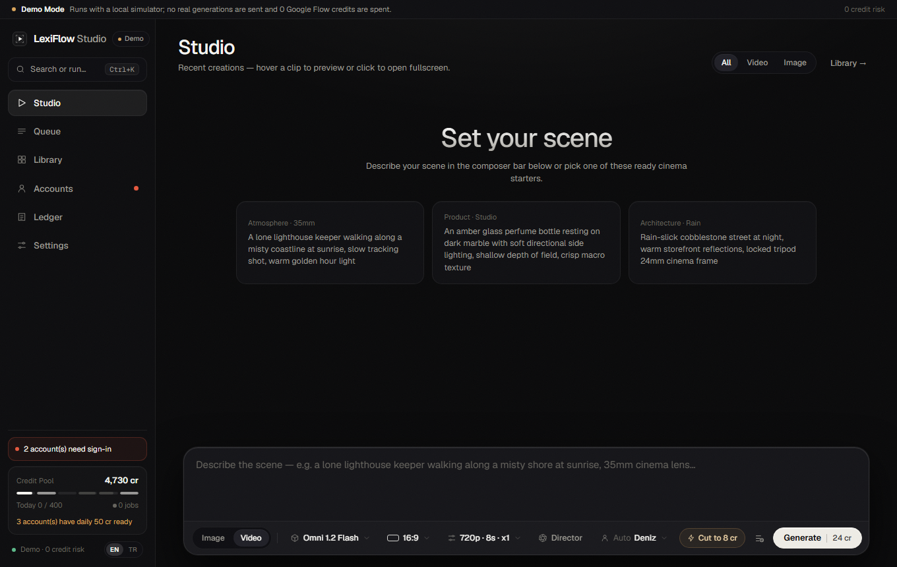

# LexiFlow Studio

A local, multi-account desktop workspace for Google Flow featuring pre-flight credit checks, smart pool routing, a scene Director pipeline, local FFmpeg media tools, and an isolated browser session manager.



> [!IMPORTANT]
> **Disclaimer**: LexiFlow Studio is an independent, unofficial utility and is not affiliated with, endorsed by, or sponsored by Google LLC. The application runs strictly locally on your machine without external telemetry, remote servers, or third-party data collection. Browser automation operates through standard local browser sessions without anti-bot bypasses or stealth evasion. You are solely responsible for your accounts and for complying with Google's Terms of Service.

## Overview

LexiFlow Studio organizes Google Flow generation workflows around a local dashboard (`http://127.0.0.1:47800`) and persistent, per-account browser profiles stored on your own PC. Before any prompt runs, the workspace verifies the active model tier, duration, resolution, and account balance so you never overspend credits unintentionally.

## Features

- **Multi-Account Pool & Smart Routing**: Manage multiple Google Flow accounts side by side with isolated browser profiles, daily bonus awareness, and automatic best-fit account selection.
- **Pre-Flight Cost Gate**: Estimates credit usage locally across Veo, Imagen, and Omni presets before queuing or dispatching a job, plus a local SQLite ledger for tracking daily spending.
- **Director & Local FFmpeg Pipeline**: Chain multi-shot storyboards, stitch generated clips locally, extract last frames for continuity, scale resolution, crop aspect ratios, and burn subtitles with zero cloud re-uploads.
- **Interactive Media Library**: Preview video and image outputs directly in Studio or Library with hover playback, mute/unmute controls, fullscreen inspection, and local export presets.
- **Bilingual Interface**: Switch between English and Turkish directly from the sidebar at any time.
- **Built-In Portable Auto-Updater**: Checks GitHub Releases for newer versions, verifies the binary against its SHA-256 digest before applying, and swaps the portable executable cleanly without touching your local workspace data.
- **Demo Mode (`--demo`)**: Launch with `LexiFlowStudio.exe --demo` to explore the interface using the built-in local simulator with zero credit risk.

## Download

Download the latest portable Windows executable from the [Releases](https://github.com/lexi-apps/LexiFlowStudio/releases/latest) page:

1. Download `LexiFlowStudio.exe` and (optionally) `SHA256SUMS.txt`.
2. Place `LexiFlowStudio.exe` in any folder you prefer (no installer required).
3. Double-click `LexiFlowStudio.exe` to launch the workspace in your browser or app window.

## Requirements

- Windows 10 or Windows 11 (64-bit)
- A Chromium-based browser installed locally (Brave, Google Chrome, or Microsoft Edge)
- Optional: FFmpeg for local stitching, cropping, and subtitle rendering (can be installed automatically from **Settings** inside the app)

## Verifying the Download & Windows SmartScreen

Because `LexiFlowStudio.exe` is distributed without a commercial Authenticode code-signing certificate, Windows SmartScreen may display a warning prompt on the first launch. You can verify the integrity of your download against the published `SHA256SUMS.txt` file in PowerShell before running it:

```powershell
Get-FileHash .\LexiFlowStudio.exe -Algorithm SHA256
```

Compare the output hash with the value listed in `SHA256SUMS.txt` from the matching release.

## Auto-Updates & Data Storage

All application state, SQLite databases, generated media, and browser profile directories are stored locally under:

```text
%LOCALAPPDATA%\LexiFlowStudio
```

When a newer release is published, LexiFlow Studio checks for updates automatically or on demand under **Settings > System & Updates**. Applying an update verifies the downloaded executable's SHA-256 hash, replaces `LexiFlowStudio.exe` in place, and preserves everything inside `%LOCALAPPDATA%\LexiFlowStudio`.

## License & Feedback

LexiFlow Studio is distributed as closed-source freeware under the terms in [LICENSE](LICENSE).

To report a bug or request a feature, please open an issue on [GitHub Issues](https://github.com/lexi-apps/LexiFlowStudio/issues).
